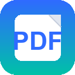
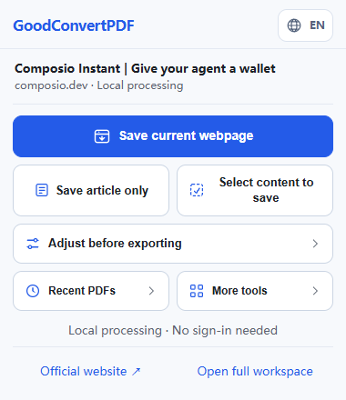
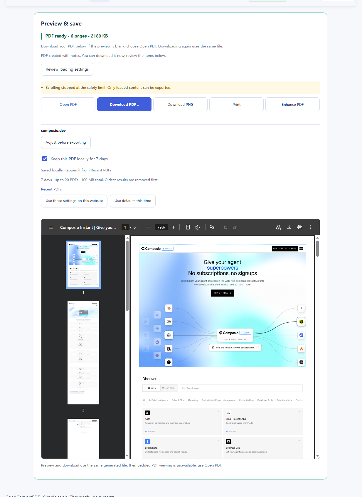
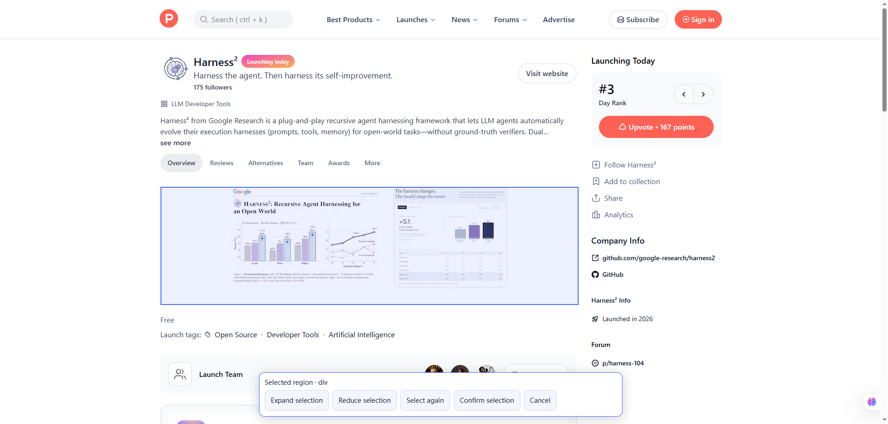
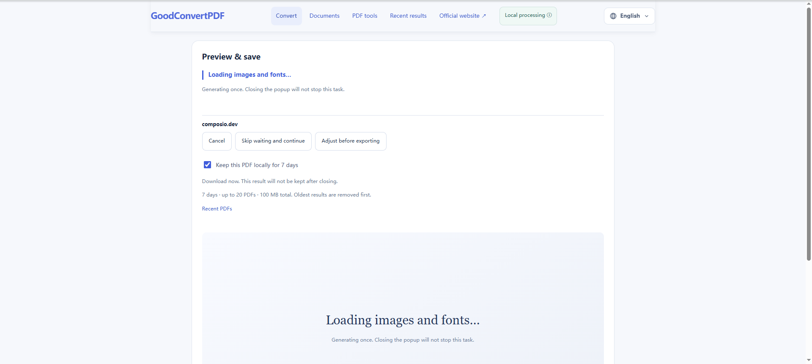
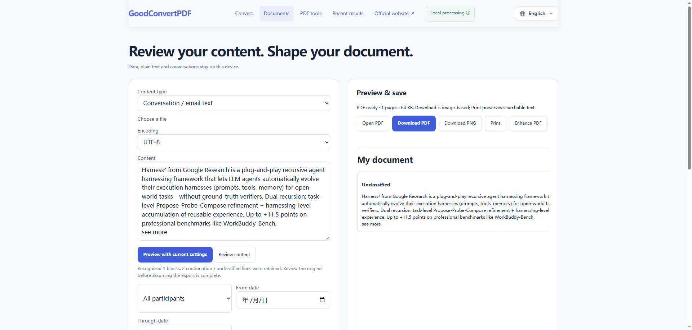
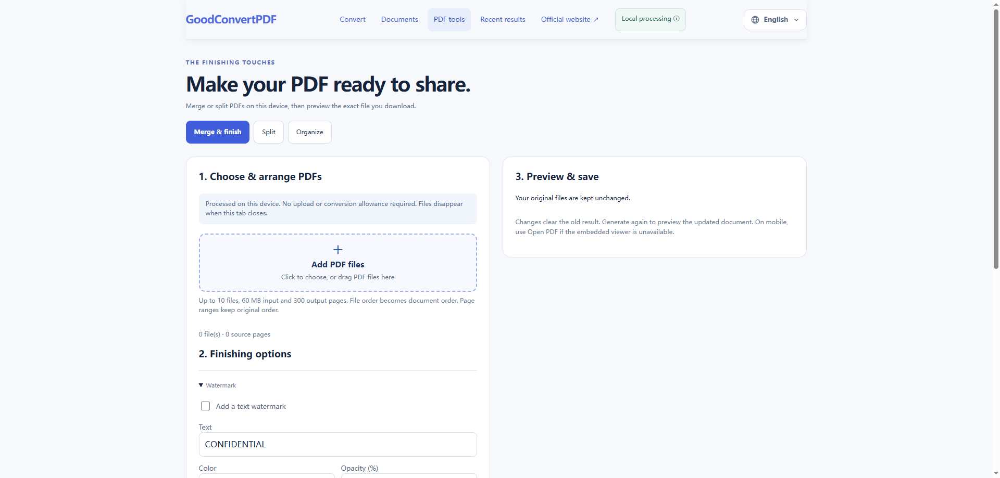
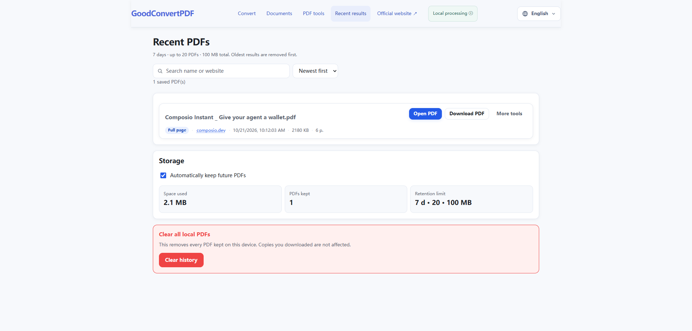

<div align="center">

<a href="https://goodconvertpdf.com/" target="_blank" rel="noopener noreferrer"></a>

# GoodConvertPDF Local

**Salve páginas da web, artigos e conteúdo selecionado em PDF. Converta documentos e organize PDFs no navegador.**

Processamento local · Sem necessidade de conta · Chrome / Edge

[English](README.md) · [Deutsch](README.de.md) · [Français](README.fr.md) · [Español](README.es.md) · **Português (Brasil)** · [日本語](README.ja.md) · [简体中文](README.zh-CN.md)

[](LICENSE)
<a href="https://goodconvertpdf.com/" target="_blank" rel="noopener noreferrer"></a>

<a href="https://goodconvertpdf.com/" target="_blank" rel="noopener noreferrer">Visitar o site oficial ↗</a> · [Instalação](#início-rápido) · [Capturas](#capturas-de-tela) · [Licença](#licença)



</div>

## Recursos

- Gere um PDF da aba aberta, confira a prévia e abra ou baixe o arquivo.
- Salve a página inteira, o artigo principal ou uma seleção visual.
- Ajuste papel, orientação, margens, escala, fundos e carregamento; reutilize as configurações de um site.
- Acompanhe as etapas da geração, cancele uma tarefa ou pule a espera pelos recursos.
- Converta localmente HTML, imagens, texto, Markdown, dados e conteúdo de conversas.
- Mescle e divida PDFs, organize páginas e adicione marcas d’água, números de página, capa e metadados.
- Reabra PDFs recentes salvos no dispositivo. Por padrão, eles ficam por 7 dias, até 20 arquivos e 100 MB no total.

## Escolher a extensão ou o site

| Uso | Extensão local da comunidade (este repositório) | Site |
| --- | --- | --- |
| Página aberta ou com sessão iniciada | Salvar a página, o artigo ou uma seleção no Chrome / Edge. | Use a extensão para páginas que exigem sua sessão do navegador. |
| URL pública | Abra a página e exporte localmente. | Cole uma URL pública para conversão no servidor; processamento em lote disponível. |
| Onde ocorre o processamento | No navegador; as páginas de origem ainda podem carregar recursos remotos. | URLs públicas no servidor; HTML, imagens e documentos locais no navegador. |
| Conta e cota na nuvem | Os recursos locais não exigem conta nem créditos de conversão na nuvem. | Ferramentas locais sem conta; conversão online com conta e a cota do plano. |

<a href="https://goodconvertpdf.com/pt-BR/" target="_blank" rel="noopener noreferrer">Experimentar o site ↗</a> · <a href="https://goodconvertpdf.com/pt-BR/pricing.html" target="_blank" rel="noopener noreferrer">Planos e limites atuais ↗</a>

## Início rápido

Você precisa de **Node.js 22 ou mais recente**, Git e Chrome ou Edge para computador.

```sh
git clone https://github.com/coosee108/goodconvertpdf-local.git
cd goodconvertpdf-local
npm test
npm run build
```

1. Abra `chrome://extensions` ou `edge://extensions`.
2. Ative o **modo do desenvolvedor** e escolha **Carregar sem compactação**.
3. Selecione a pasta gerada **`build/`**.
4. Abra uma página comum, salve-a em PDF, confira a prévia e baixe o resultado.

Não é necessário executar `npm install` nesta versão: as dependências do navegador já estão incluídas. Depois de alterar o código, gere o build novamente e recarregue a extensão. Esta edição comunitária é para Chrome e Edge; a implementação separada do Firefox usa impressão nativa.

## Capturas de tela

As imagens foram fornecidas pelo mantenedor. Os rótulos podem variar conforme a versão e o idioma. Páginas de terceiros aparecem apenas como exemplos.



<details><summary>Mais capturas: seleção, carregamento, documentos, ferramentas PDF e resultados recentes</summary>







</details>

## Privacidade e permissões

A conversão local não exige conta nem servidor de conversão. A página de origem ainda pode carregar imagens, fontes e outros recursos externos. A extensão solicita acesso a abas, scripts, armazenamento, downloads, depuração e sites para ler a página, gerar o PDF e salvar os resultados. Chrome ou Edge pode mostrar um aviso de depuração.

Os PDFs recentes são salvos no IndexedDB da extensão. A limpeza ocorre nas verificações, sem horário garantido de exclusão enquanto o navegador estiver fechado. Resultados da navegação anônima não são mantidos.

## Perguntas frequentes

**Por que algumas páginas não podem ser salvas?** Páginas protegidas do navegador e páginas de extensões não podem ser convertidas. Abra uma página HTTP(S) comum.

**Posso salvar uma página com login?** É possível tentar salvar uma página já aberta sem enviar suas credenciais a um serviço de conversão. Restrições do site podem afetar o resultado.

**O texto pode ser selecionado?** A impressão de páginas geralmente preserva texto e links. Algumas exportações de HTML ou documentos locais usam imagens; use Imprimir quando precisar de texto pesquisável.

**Preciso de uma conta?** Não para os recursos locais. A conversão online e os planos são gerenciados no <a href="https://goodconvertpdf.com/" target="_blank" rel="noopener noreferrer">site oficial ↗</a>.

## Desenvolvimento e contribuições

`extension/` contém o código, `locales/` as traduções e `docs/screenshots/` as imagens. `build/` é gerado. Execute `npm test` e `npm run build` e confira a qualidade do PDF em um navegador real. Consulte [CONTRIBUTING.md](CONTRIBUTING.md) e [SECURITY.md](SECURITY.md).

## Licença

O código criado pela GoodConvertPDF é disponibilizado sob a [licença MIT](LICENSE). Dependências de terceiros mantêm suas licenças; veja [THIRD_PARTY_NOTICES.md](THIRD_PARTY_NOTICES.md) e `extension/vendor/licenses/`.
